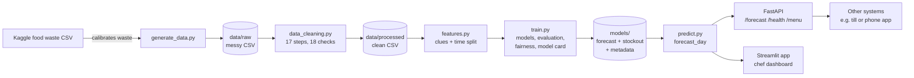

# Architecture (Phase 8.5)

## Layers
| Layer | Files | Job |
|---|---|---|
| Data | `src/generate_data.py`, `src/data_cleaning.py` | Create and clean data, log every change |
| Features | `src/features.py` | Turn raw columns into model clues; split past vs future |
| Model | `src/train.py` | Train, tune, evaluate, explain, save |
| Serving | `src/predict.py`, `api/main.py` | One forecast function, shared by the API and the app |
| Interface | `app/` (Phase 9) | Chef dashboard in Streamlit |
| Quality | `tests/` | 25 automated tests (cleaning, predictions, API) |

## Why this design
- **One `forecast_day()` function** used by both the API and the app, so they can never disagree.
- **Models saved as files** (joblib): the app loads them in milliseconds, no retraining at runtime.
- **Settings in one file** (`config.py`): change a date or path once.
- **Scales up:** for many sites, add a `site` column and train one model across sites; swap the CSV for
  a database (e.g. PostgreSQL) without touching the model code.
